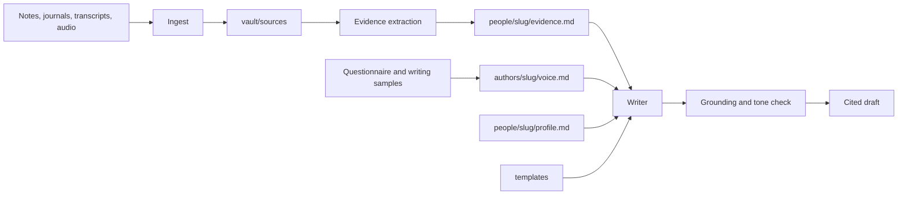

# Backpat

Backpat turns your own records about a person into grounded writing about them. Your records can be 1:1 notes, journal entries, meeting transcripts or chats. The writing can be peer feedback, performance reviews, LinkedIn recommendations, kudos or reference letters. Every claim cites the moment it came from. Drafts are written in your voice and adapted to how the recipient likes to receive feedback.

> **Status:** early design. The product is specified but not built yet. There is no application code in this repository so far.

## Who it is for

- **Individual contributors** writing peer feedback and recommendations.
- **Managers** writing reviews and ongoing feedback for their direct reports.

## How it works

1. **Ingest** raw notes and transcripts into a local markdown vault.
2. **Extract** dated, cited observations into an evidence log for each person. The log grows over time instead of being rebuilt at review season.
3. **Profile** the author's writing voice (a short questionnaire plus a few writing samples) and the recipient's feedback preferences.
4. **Write** a draft from a template: LinkedIn recommendation, peer feedback, manager review, kudos, reference letter or growth feedback.
5. **Check** the draft for unsupported claims, generic phrasing, biased wording and private details in public outputs.

## Principles

The full rules are in the [constitution](.specify/memory/constitution.md). In short:

- **Evidence over generation.** No claim without a cited, dated source. Nothing is invented.
- **Local-first.** The vault on your machine is the source of truth. Hosted models are optional, and their inputs are redacted.
- **Audience boundaries.** Private evidence never appears in public outputs.
- **Tone, not facts.** Voice and recipient profiles change wording only.
- **Human in the loop.** Backpat writes drafts. It never sends anything, and it never scores or ranks people.

## Roadmap

1. **Idea assessment**: market, source integrations, GDPR and EU AI Act constraints, technical approaches.
2. **Agent skills** for Cursor or Claude Code, working on a markdown vault: ingest, extract, voice, person, write, check.
3. **Local-first app**: a Python command-line tool with the same vault format, audio transcription and an evaluation suite.

## Repository layout

| Path | Contents |
| --- | --- |
| [`.specify/memory/constitution.md`](.specify/memory/constitution.md) | Project principles, constraints and quality gates |
| [`docs/briefs/`](docs/briefs/) | Feature briefs used as input to Spec Kit (overview, research, vault format, profiles, templates, skills, app, privacy and evaluation) |
| [`AGENTS.md`](AGENTS.md) | Rules for coding agents, covering privacy, security and testing |
| `.specify/`, `.cursor/skills/speckit-*` | [Spec Kit](https://github.com/github/spec-kit) 1.4.3 setup for the Cursor agent |

## Development

Backpat is built with spec-driven development using [Spec Kit](https://github.com/github/spec-kit). Each feature goes through `/speckit-specify`, `/speckit-clarify`, `/speckit-plan`, `/speckit-tasks`, `/speckit-implement` and `/speckit-converge` in Cursor. The briefs in `docs/briefs/` are the starting input, and each brief is retired once its feature's spec replaces it.

Contributions go through pull requests using the [PR template](.github/pull_request_template.md). Read [`AGENTS.md`](AGENTS.md) before changing anything that touches vault data.

## License

Backpat is licensed under the [Apache License 2.0](LICENSE). The Spec Kit files in `.specify/` and `.cursor/skills/speckit-*` come from [Spec Kit](https://github.com/github/spec-kit) and are MIT-licensed. See [NOTICE](NOTICE).
