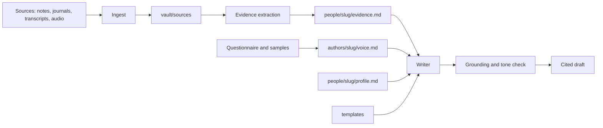

# 00 - Overview

## Purpose
Backpat turns your own records about a person (1:1 notes, journal entries, meeting transcripts, chats) into grounded, cited writing about them: feedback, performance reviews, LinkedIn recommendations, kudos, reference letters. The output is written in the author's voice and adapted to the recipient.

## Users
- **Individual contributors** writing peer feedback and recommendations.
- **Managers** writing reviews and ongoing feedback for their direct reports.

## Principles
- **Evidence over generation.** Every claim traces back to a dated source moment.
- **Accumulate, don't summarize once.** A per-person evidence log grows over time.
- **Personal voice.** Drafts match the author's style, based on a questionnaire and writing samples.
- **Recipient-aware.** Tone and framing adapt to how the person likes to receive feedback.
- **Local-first.** Data stays on disk as markdown. Hosted models are optional and their inputs are redacted.

## Architecture

## Stages
1. **Research**: [01-research.md](01-research.md)
2. **Agent skills** on a markdown vault: [02](02-vault-format.md), [03](03-voice-profile.md), [04](04-recipient-profile.md), [05](05-output-templates.md), [06](06-skills.md)
3. **Local-first app** using the same vault: [07-app.md](07-app.md)

Privacy and evaluation apply to every stage: [08-privacy-and-eval.md](08-privacy-and-eval.md)

## Spec format
Every spec contains: Purpose, Requirements, Open questions, Acceptance criteria.
